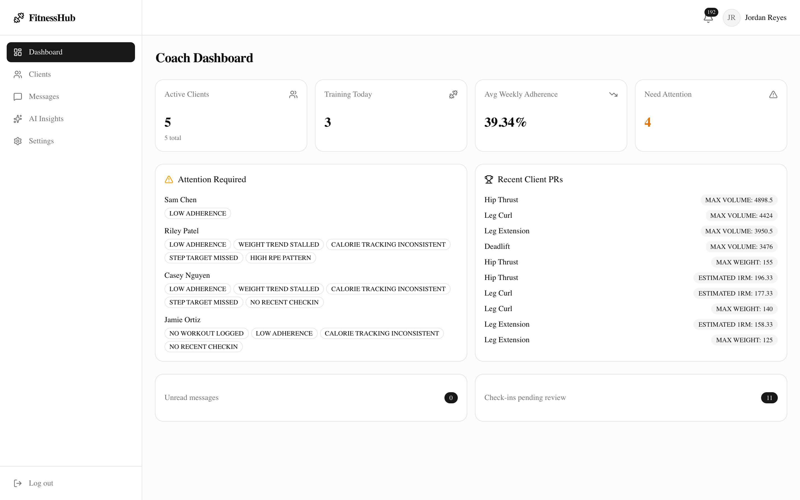
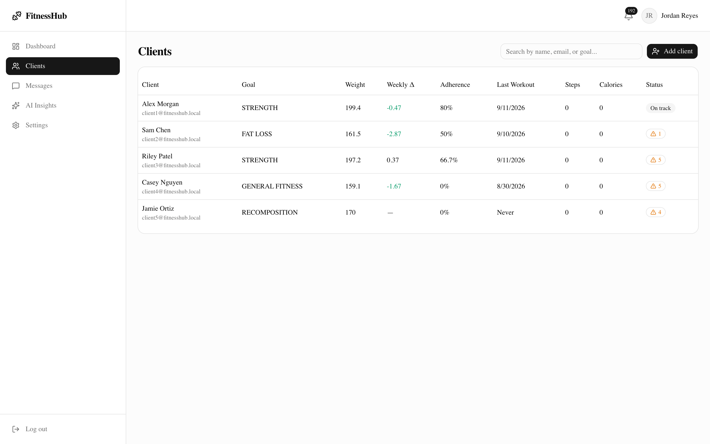
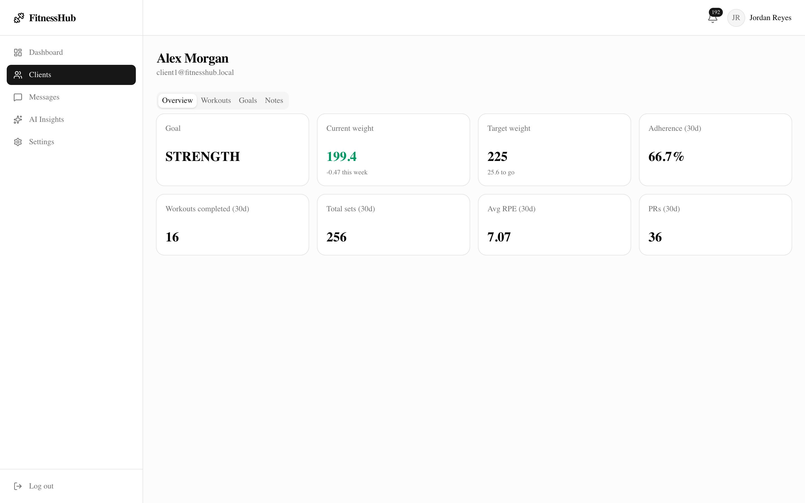
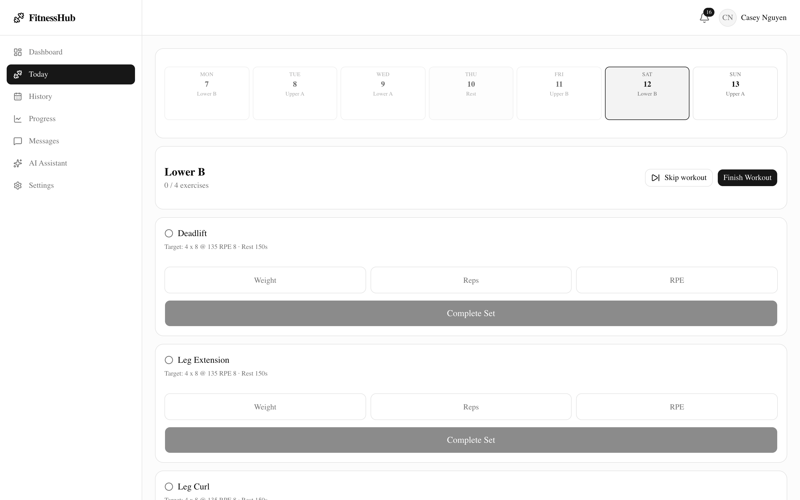
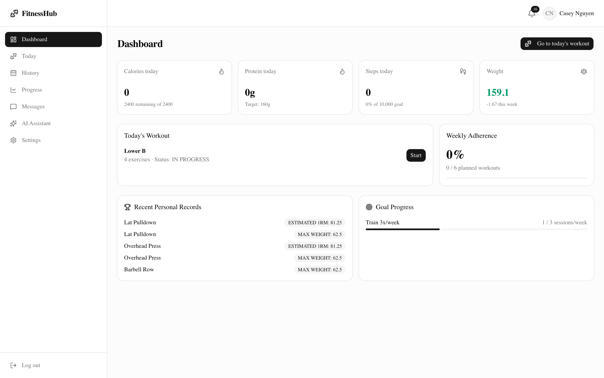
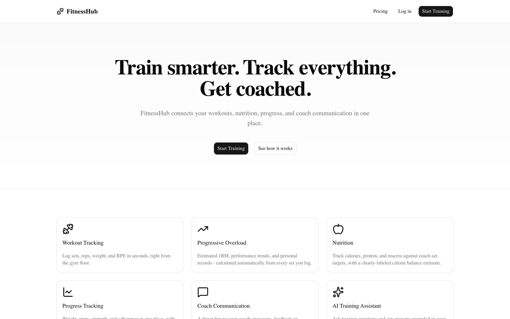

# FitnessHub

[](https://github.com/amrkasaOSU/fitnesshub/actions/workflows/ci.yml)

**Train smarter. Track everything. Get coached.**

A full-stack fitness coaching platform: workout tracking with progressive-overload
analytics, nutrition/weight/step tracking, coach-client messaging and check-ins,
a data-grounded AI training assistant, and Stripe-based subscriptions.

> **On the AI assistant and Stripe:** both sit behind provider abstractions
> that degrade gracefully. With no `OPENAI_API_KEY` set, the AI endpoints
> return a clear "not configured" message rather than erroring, and every
> other feature works untouched - so the app runs fully without any paid
> third-party account. Add a key to `.env` to switch the assistant on; any
> OpenAI-compatible endpoint works via `OPENAI_BASE_URL`. Same story for
> Stripe. See [docs/ai.md](docs/ai.md).

- **Backend:** Java 21, Spring Boot 3, Spring Security (session/cookie auth),
  Spring Data JPA, PostgreSQL, Redis, Flyway, Maven.
- **Frontend:** Next.js (App Router), TypeScript, Tailwind CSS, shadcn/ui,
  TanStack Query, React Hook Form + Zod, Recharts.
- **Architecture:** Next.js frontend → Spring Boot REST API → PostgreSQL, with
  Redis for sessions/rate limiting/caching. Modular monolith, not microservices.

## Why I built this

I train clients, and the admin side of coaching was the part that didn't scale.
Programs live in one place, logged workouts in another, and progress questions
like "is this person actually getting stronger, or just showing up?" take real
digging to answer. The tools that do exist are either priced for gyms rather
than individual coaches, or they're a workout logger with no coach side at all.

So I built the thing I wanted: a coach assigns a program once, the client logs
sets from their phone between sets at the gym, and the coach's dashboard
surfaces the parts that need attention on its own - who's fallen off, whose
numbers have stalled, who hasn't checked in. Every number a client sees is the
same number their coach sees, because both come from the same server-side
calculation.

## Screenshots

| Coach dashboard | Client roster |
|---|---|
|  |  |
| Attention flags surface which clients need a nudge, with recent PRs alongside. | Searchable roster with weight trend, adherence, and per-client flag counts. |

| Client detail | Today's workout |
|---|---|
|  |  |
| Current weight beside target, plus 30-day training summary. | Monday-Sunday week strip, per-set logging, and skip-with-reason. |

| Client dashboard | Landing page |
|---|---|
|  |  |
| Calories, protein, steps, weight, and today's session at a glance. | Public marketing page. |

All screenshots are of the running application against the seeded demo data.

## Engineering highlights

The decisions I'd want to talk through, each linked to where it lives:

- **All fitness math runs server-side.** 1RM, volume, adherence, PR detection
  and attention flags are computed in one place, so a client and their coach
  can never see different numbers for the same metric. Every formula and the
  assumptions behind it are written down in
  [docs/fitness-calculations.md](docs/fitness-calculations.md).
- **One place decides who can see what.** `CurrentUser` is the only source of
  caller identity and `AuthorizationService` the only place ownership is
  checked, so no endpoint can accidentally trust a client-supplied ID. Role
  rules in `SecurityConfig` are a coarse first filter, not the real check -
  [docs/security.md](docs/security.md).
- **The weekly schedule is derived, not stored.** When a client skips a
  session, the rest of the week shifts down. Rather than persist an offset that
  could drift, the schedule is computed as
  `(daysSinceStart - skipsThisWeek) % cycleLength` from the skip records
  themselves, so it self-corrects every Monday with no background job.
- **Third-party outages are non-events.** OpenAI and Stripe sit behind
  interfaces that return typed "not configured" results instead of throwing.
  The app runs completely without either - [docs/ai.md](docs/ai.md).
- **Progress photos are private by construction.** Body photos are the most
  sensitive thing here, so the bytes are served only through a
  session-authenticated endpoint - there is no shareable URL. A coach can view
  a client's gallery but cannot upload to or delete from it, and listing a
  gallery projects metadata only so image data is never loaded to render
  thumbnails.
- **Tested against real infrastructure, not mocks.** 81 integration tests boot
  the app against real PostgreSQL and Redis containers and attack it over
  HTTP; run against the unchanged code first, they found five real bugs,
  including session fixation. See [RESULTS.md](RESULTS.md#23-bugs-the-new-tests-found).
- **Performance work driven by measurement.** The coach dashboard issued
  67,801 SQL statements for a 200-client coach; batching per table and
  pure-function analytics cut it to 18. When a load test seemed to show a
  regression, an interleaved A/B traced it to CPU power management, not the
  code. See [RESULTS.md](RESULTS.md#3-performance-n1-queries-indexes-caching).

## Results

Measured, not estimated. Every number below comes from a command that was run
on a local Docker stack (Apple M4, Colima VM limited to 6 CPUs / 8 GB) and is
reproducible from [RESULTS.md](RESULTS.md), which lists the exact command,
raw output and caveats for each. These are test-environment measurements, not
production traffic.

| What | Before | After |
|---|---:|---:|
| Automated tests | 20 unit | **103 backend (22 unit + 81 integration on real PostgreSQL/Redis) + 17 Playwright E2E** |
| Backend line coverage (JaCoCo) | 4.1% | **77.7%** |
| Coach dashboard, coach with 200 clients - SQL statements per load | 67,801 | **18** |
| Coach dashboard, coach with 200 clients - median response | 5,278 ms | **239 ms** (-95.5%) |
| p95 latency, 500 concurrent users (k6, seeded data) | 46.5 ms | **13.8 ms** (-70.3%) |
| p99 latency, 500 concurrent users | 124.9 ms | **24.6 ms** (-80.3%) |
| Throughput ceiling (no think time, 100 VUs) | 1,072 req/s | **1,972 req/s** (+83.9%) |
| Unread-notification query, 80k rows (EXPLAIN ANALYZE) | 2.025 ms | **0.054 ms** (index-only scan) |
| Lighthouse accessibility, signed-in pages | 89-96 | **100** on every audited page |
| AI assistant accuracy (25-question graded eval) | 28% (7/25) - context bug | **100% (25/25)** |
| AI assistant latency, end to end | - | **p50 1037 ms, p95 3,024 ms** |

**Bugs found by the new tests and measurements, all fixed:** session fixation
on login; three `/api/clients/{id}/...` endpoints answering 200 for someone
else's id; opening the app counted as "training today"; the dashboard handing
out a workout id that was never saved; timezones never recorded, so "today"
rolled over at 7 pm for a US client; the AI assistant sending the model an
empty context (`{}`) for every question; progress bars invisible to screen
readers; a newly added client missing from the roster; and, in the tooling
itself, a Lighthouse setup that had been scoring signed-in pages whose data
never loaded. Each is written up in RESULTS.md with how it was found.

## Quick start (Docker)

```bash
cp .env.example .env
docker compose up --build
```

- Frontend: http://localhost:3000
- Backend API: http://localhost:8080
- API docs (Swagger UI): http://localhost:8080/swagger-ui.html

The backend seeds realistic demo data on first boot against an empty database
(see **Demo accounts** below) - no manual setup needed.

## Demo accounts

All demo accounts use the password `FitnessHub!2024`.

| Role   | Email                        | Story |
|--------|-------------------------------|-------|
| Coach  | coach@fitnesshub.local        | Manages all 5 clients below |
| Client | client1@fitnesshub.local      | Strength goal, bench press progressing well, high adherence, several PRs |
| Client | client2@fitnesshub.local      | Fat loss goal, weight trending down, steps improving |
| Client | client3@fitnesshub.local      | Strength plateau, high RPE, inconsistent nutrition logging - trips several attention flags |
| Client | client4@fitnesshub.local      | Inconsistent workout logging, low adherence |
| Client | client5@fitnesshub.local      | Brand-new client, almost no history |

Client 1's bench press history is deliberately built so that "should I attempt
225 today?" has a real answer in the data: weight climbing 185 -> 200 with RPE
rising alongside it and estimated 1RM flattening out. The AI assistant reasons
from those logged sets rather than returning a canned response - see
[docs/ai.md](docs/ai.md).

## Local development (without Docker)

You need JDK 21, Maven, Node 20+, PostgreSQL 16, and Redis 7 on your machine.

```bash
# Backend
cd backend
./mvnw spring-boot:run
# reads DATABASE_URL / POSTGRES_USER / POSTGRES_PASSWORD / REDIS_URL from the
# environment (see .env.example), defaulting to localhost.

# Frontend (separate terminal)
cd frontend
npm install
npm run dev
```

See [docs/development.md](docs/development.md) for the full local setup,
including how this was verified without Docker during initial development.

## Documentation

- [docs/architecture.md](docs/architecture.md) - system architecture, module layout
- [docs/database.md](docs/database.md) - schema, entity relationships, key design decisions
- [docs/api.md](docs/api.md) - REST API conventions and endpoint index
- [docs/security.md](docs/security.md) - auth, authorization, session/CSRF model
- [docs/ai.md](docs/ai.md) - AI assistant pipeline, provider abstraction, safety
- [docs/fitness-calculations.md](docs/fitness-calculations.md) - every formula (1RM, volume, adherence, calorie estimates, attention flags) and what it assumes
- [docs/development.md](docs/development.md) - local dev, testing, seed data
- [docs/deployment.md](docs/deployment.md) - running it for real: the production profile, required environment, and why both halves belong on one domain
- [docs/deployment-oracle.md](docs/deployment-oracle.md) - zero-cost deployment on an always-on VM, single-origin behind Caddy
- [docs/deployment-render.md](docs/deployment-render.md) - zero-cost deployment across Vercel, Render, Neon and Upstash when no always-on host is available

## Testing

```bash
cd backend
./mvnw test        # 22 unit tests - pure calculations, no database
./mvnw verify      # + 81 integration tests on real PostgreSQL and Redis (Testcontainers, needs Docker)
```

```bash
docker compose -f loadtest/docker-compose.loadtest.yml --profile ui up -d --build
loadtest/wait-ready.sh
cd frontend && npm run e2e     # 17 Playwright tests, desktop + phone viewport
```

The integration tests drive the real app over HTTP with real session cookies
and CSRF, including 37 cross-tenant attack cases proving one client can't read
or change another's data. All three layers run in GitHub Actions on every
push. Load tests, query analysis, Lighthouse and the AI evaluation live in
[`loadtest/`](loadtest/); see [docs/development.md](docs/development.md).

## Known limitations

Stated plainly rather than buried:

- **Not yet proven under real traffic.** Every performance number here comes
  from a local test stack with seeded and synthetic data. The live free-tier
  deployment has a fraction of that hardware and sleeps when idle, so its
  first request after a quiet period takes about 50 seconds.
- **The coach dashboard still does real work at scale.** For a coach with 200
  clients it takes about 240 ms, most of it one query that finds each
  client's last three sessions per exercise for the attention flags. The fix
  is to maintain those as workouts are completed instead of computing them on
  read (RESULTS.md, section 3.3).
- **The AI evaluation is small and self-written.** 25 questions over five
  demo clients, graded automatically. It catches grounding, safety and
  regressions; it is not a benchmark of answer quality, and the free tier's
  rate limits keep each run to a single pass.
- **Paid plans are off.** Stripe sits behind the same "not configured"
  abstraction as the AI; add test keys and it turns on without a frontend
  change.
- **No email delivery.** Password recovery runs through the coach, who can set
  a temporary password; email verification has schema fields but no sender.

## Disclaimer

FitnessHub is a fitness tracking and coaching tool. Information provided by
the application or AI assistant is for general informational purposes and is
not medical advice. Consult an appropriately qualified healthcare professional
for medical concerns, injuries, or health conditions.
